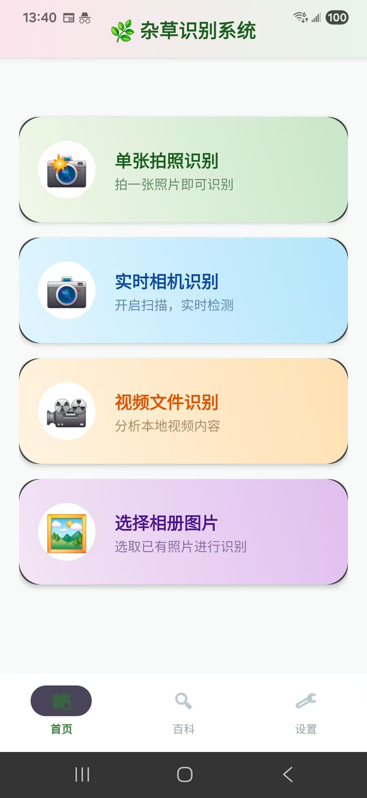

# 🌿 WeedDetect: 智能杂草识别系统


基于深度学习的一农田杂草检测方案。本项目通过 **YOLO** 架构训练，并利用 **TensorFlow Lite** 实现移动端边缘计算推理

---

## 📱 界面预览

系统采用模块化设计，确保核心功能一触即达。

| 首页入口 (Home) | 杂草百科 (Info) | 系统设置 (Settings) |
| :---: | :---: | :---: |
|  |  |  |
| *清新粉绿卡片布局* | *详尽的防治数据库* | *个性化识别配置* |

---

## ✨ 核心功能

* **📸 单张拍照识别**：针对特定植物进行高精度对比分析。
* **📷 实时相机监测**：采用高性能 `SurfaceView` + `CameraX` 渲染，支持移动过程中流畅的动态检测。
* **🎥 视频文件分析**：支持导入本地录像，适合大面积农田回溯调查。
* **🖼️ 相册智能选图**：随时调取手机存储照片进行后期识别。
---

## 🛠️ 技术深度：模型部署架构

为了实现在安卓端的秒级响应，我们采用了从 PyTorch 到端侧的完整转换链路：

### 1. 模型转换链路

1.  **训练**: 使用 YOLOv8/v10 在自定义杂草数据集上训练。
2.  **导出**: 将 `.pt` 权重转换为中间格式：
    ```bash
    yolo export model=weed_best.pt format=tflite int8=true
    ```
3.  **集成**: 将生成的 `weed_model_quant.tflite` 放入 Android 项目的 `assets` 目录。

### 2. UI 渲染策略 (Elevation Z-Axis)
针对渲染层级冲突（如预览流遮挡 UI），本系统采用了分层策略：
* **Top Bar (12dp)**: 粉绿渐变设计，固定于顶部，最高视觉反馈。
* **Interaction Layer (4dp)**: 操作区卡片，通过 Elevation 阴影增强点击感。
* **Bottom Nav (24dp)**: 独立高层级，彻底杜绝导航按钮因 SurfaceView 置顶导致的失效问题。
---

## 🚀 快速开始

### 环境准备
* **IDE**: Android Studio Jellyfish (2024.1.1) 或更高版本。
* **JDK**: Version 17。
* **Model**: 确保 `.tflite` 文件位于 `app/src/main/assets/`。

### 编译适配
在 `gradle.properties` 中确保兼容新版 Gradle 插件：
```properties
# 适配新版 Gradle，移除过时的原生库压缩配置
android.bundle.enableUncompressedNativeLibs=false
```

### 获取源码

```bash
git clone [https://github.com/lijin6/weeddetectionapp.git](https://github.com/lijin6/weeddetectionapp.git)

```


## 🤝 贡献与反馈

欢迎提交 Issue 或 Pull Request 来优化识别精度。

---

### 💡 下一步建议
由于你从 YOLO 转到了 TFLite，你可能需要处理 **元数据（Metadata）** 填充或者 **输入输出张量（Tensor）** 的预处理代码。
