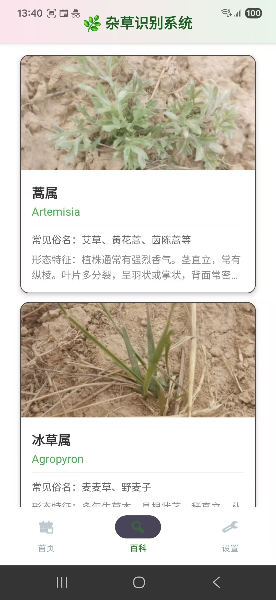

# 🌿 智能杂草识别系统 (Weed Detection App)

基于深度学习的一站式杂草识别解决方案

---

## 📱 界面预览

我们将核心功能入口与百科设置进行了模块化展示

| 首页入口 (Home) | 杂草百科 (Info) | 系统设置 (Settings) |
| :---: | :---: | :---: |
|  |  |  |
| *清新粉绿卡片布局* | *详尽的防治数据库* | *个性化识别配置* |
---

## ✨ 核心功能

* **📸 单张拍照识别**：针对特定植物进行高精度对比分析。
* **📷 实时相机监测**：采用高性能 `SurfaceView` 渲染，支持移动过程中流畅的动态检测。
* **🎥 视频文件分析**：支持导入本地录像，适合大面积农田回溯调查。
* **🖼️ 相册智能选图**：随时调取手机存储照片进行后期识别。

---

## 🛠️ 技术深度：层级架构设计

针对 Android 开发中 `SurfaceView` 可能出现的渲染层级冲突（如遮挡 UI 或点击失效），本系统采用了 **Elevation Z-Axis 分层策略**，确保交互层始终处于渲染的最上方。

* **Top Bar (12dp)**：采用粉绿渐变设计，固定于屏幕顶部，提供最高级别的视觉反馈。
* **Interaction Layer (4dp)**：主操作区的卡片与 ScrollView，通过海拔（Elevation）阴影增强点击感。
* **Bottom Nav (24dp)**：底部导航层拥有独立的高层级 Elevation，彻底杜绝导航按钮失效的问题。

---

## 🚀 快速开始

### 环境准备

1. **IDE**: Android Studio Jellyfish 或更高版本。
2. **JDK**: 推荐使用 Version 17。
3. **配置适配**: 确保 `gradle.properties` 中已移除过时的 `android.bundle.enableUncompressedNativeLibs` 以适配新版 Gradle 插件。

### 编译运行

1. **获取源码**:
   ```bash
   git clone https://github.com/your-username/weed-detection-app.gi
